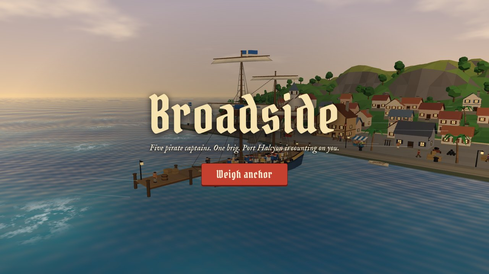
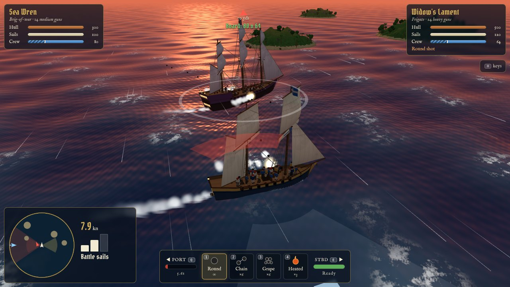
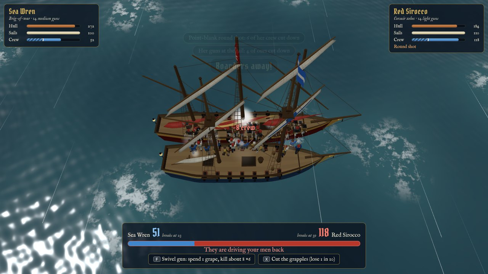
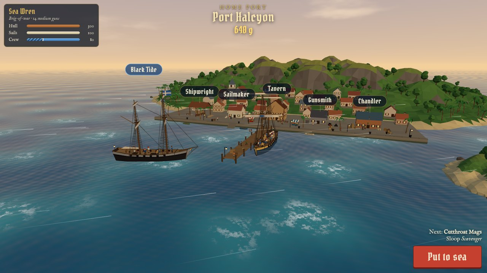

# Broadside

Age-of-sail ship combat in the browser, with a story campaign set in the Cretan War (1645–1669).
You are an Aegean island captain who takes a commission with Venice or with the Ottoman fleet, and
the war ends in the harbour of Candia. The original game, a ladder of five pirate captains, is
still there as a skirmish mode.

**[Play it in your browser](https://joelq.github.io/broadside/)** — desktop or phone, nothing to install.

[](https://joelq.github.io/broadside/)

| | |
| --- | --- |
|  |  |
|  | Fight with guns, sail and steel; spend the bounty in port; sail any ship you capture. |

## The game

- Guns fire only from the sides, inside a limited arc; shots along the length of a hull rake for extra damage
- Wind sets your speed, you cannot sail straight into it, and the ship upwind of the other shoots straighter
- Four sail settings trade speed against steadier guns and tighter turns
- Four kinds of shot: round (hull), chain (sails), grape (crew), heated (fire)

Ships differ by weight, and the differences pull on each other:

- **Gun weight** (light, medium, heavy): heavier guns reach further and hit harder but load slowly
- **Mass**: big hulls gather way, lose way and answer the helm slowly; small ones dart
- **Firing angle**: a small ship's guns sweep wide, a big ship's only bear nearly square off her sides
- **Rig**: sloops and xebecs sail closer to the wind than square-riggers
- **Length**: a raking shot does more the longer the deck it travels
- **Fittings** belong to a ship and make her better at what she already is: a runner gets faster and harder to hit, a boarder gets marines, grapples and oars, a gun platform gets reach and more guns

Each ship's reach and firing angle are the arcs drawn on the water, and its wind limit is the red wedge.

Three ways to win, and each pirate favours a different one:

- **Out-gun her.** Batter the hull below 15% and she gives up as a wreck. You collect the bounty.
  Stock for stock, the bigger ship wins a plain exchange of broadsides.
- **Out-sail her.** A big ship's guns only bear nearly square off her sides. Get past them, sit
  astern and rake. This is how a small ship beats a big one.
- **Board her.** Grapples only hold a ship that has been slowed, so cut up her sails with chain
  first. Guns reach only the crew on deck (30% are always below), and a crew fights worse when
  its ship is holed or burning. A boarded prize pays up to double and is yours to sail.

Each shot has a job: round for hulls, chain to slow a ship so she can be boarded, grape to thin a
crew (and to stop a boarder), heated to burn big ships, which lose hull in proportion to their size
and load at half speed while alight.

Port Halcyon is home: your ship at the pier, shops along the quay, and every ship you own at anchor.

## The campaign

A prologue and five missions for each side (see [`docs/campaign.md`](docs/campaign.md) for the design):

| # | Episode | Venice | The Ottoman fleet |
| --- | --- | --- | --- |
| 0 | Home waters | Keep a pirate off your island's harbour | Same |
| 1 | Powder for Candia | Run the powder into the city through the patrol | Deal with the powder ship at her anchorage |
| 2 | Independent command | Three pirate fights drawn from a pool of six | Same |
| 3 | The calm | Galleys come out in a dead calm; the wind is coming | Same, under the other flag |
| 4 | The straits | Go up the Dardanelles and destroy a flagship fitting out | Come down and break the blockade at the mouth |
| 5 | Candia | Defend the harbour on the day of the assault | The assault |

- A mission is a **cruise** of two or three fights with no port between them. Hull, sails, crew and
  shot carry over. Between fights you get a **jury-rig pause** with three watches to spend on
  repairs, the wounded, stripping a prize, or shifting your flag to a ship you captured.
- A mission sets a goal, never a method: every fight can be won in at least three different ways,
  by different kinds of ship, and the harness checks this.
- You command one ship at a time, against one to three opponents. Prizes join your ships in port.
- **Galleys** have heavy guns that fire ahead, weak sides, and oars that run on stamina.
- **Wind strength** changes: a calm leaves sailing ships helpless against oars, a gale spoils gunnery
  and tears full sail.
- **Shoals** stop any ship that draws too much, yours or theirs. **Current** runs in the straits.
  **Shore batteries** draw their arcs on the water and have dead ground.
- **Anchoring on a spring** makes a ship a steady gun platform that can be hauled round in any wind.
- Four **officers** join you along the way; each bends a rule instead of raising a number.
- Progress is saved in the browser after every mission.

## Controls

| Key | Action |
| --- | --- |
| `A` / `D` | Rudder |
| `W` / `S` | Make / shorten sail |
| `Q` / `E` | Fire port / starboard battery |
| `Space` | Fire whichever side bears |
| `1`–`4` | Round, chain, grape, heated shot |
| `B` | Board when alongside at matching speed |
| `F`, `X` | During a boarding: fire the swivel gun, cut the grapples |
| `T` | Next target (your guns also fire at whatever else bears) |
| `G` | Drop or weigh anchor (on a spring: `A` / `D` haul her round) |
| `R` | Galleys: oars rest / row / sprint |
| `F` | Galleys: fire the bow guns (also `F` for the swivel gun in a boarding) |
| `V` | Camera: facing the enemy / behind your ship |
| `P`, `M` | Pause, mute |

Touch devices get on-screen buttons.

## Build

The game is plain JavaScript on [three.js](https://threejs.org), bundled by esbuild. You need Node 20 or newer.

```bash
npm install
```

```bash
npm run build
```

This writes a single self-contained page to `dist/index.html`. Open it in a browser; no server is needed.

Everything you see and hear is made in code: there are no model, texture or sound files. Ships,
crews, islands and the town are built from each ship's numbers in `src/data.js`, and the sound is
synthesized.

Pushing to `main` publishes the build to GitHub Pages. Pushing a tag, or running the Release
workflow from the Actions tab, attaches the built page to a GitHub release (see `.github/workflows`).

## Balance

Everything was tuned with a harness that plays whole battles headlessly, a scripted captain
against the game's own AI. For the campaign it plays every fight with every kind of ship along
several scripted routes and reports which ones win, so no mission has a single answer. See
[`tools/balance`](tools/balance/README.md) before changing any of the numbers.

## Layout

| File | Contents |
| --- | --- |
| `src/main.js` | Game loop, scenarios with any number of ships, gunnery, boarding, camera, HUD, port and screens |
| `src/campaign.js` | Campaign state and flow: saves, the stable, officers, briefings, the jury-rig pause |
| `src/missions.js` | Every campaign fight as data: ships, sea, wind, shoals, current and what counts as winning |
| `src/story.js` | All of the campaign's text and ship names |
| `src/fleet.js` | Campaign hulls, shore works, liveries, grades and officers |
| `src/fort.js` | Shore battery and sea fortress models |
| `src/ship.js` | Sailing physics, sail and ammunition tables |
| `src/model.js` | Procedural ship model: hull, decks, rig, sails, guns |
| `src/crew.js` | Animated figures: ship's crews and townsfolk |
| `src/geo.js` | Builder that merges coloured shapes into one mesh; shared maths |
| `src/ai.js` | Captain AI: broadsides, galleys bow-on, ships at anchor, shoals |
| `src/world.js` | Sea, sky, weather presets, wind and its strength, shoals |
| `src/land.js` | Islands, trees and rocks |
| `src/fx.js` | Particles and synthesized sound |
| `src/harbor.js` | Port Halcyon scenery and shop locations |
| `src/data.js` | Skirmish mode's ships, the five pirates, fittings and shop stock |
| `src/index.template.html` | Page markup and styles; the bundle is inlined here |
| `build.mjs` | Bundles with esbuild into `dist/index.html` |
| `tools/balance` | Headless balance harness |

## Licence

[MIT](LICENSE)
